<div align="center">



<br/>

[](https://md-sazid-hossain.github.io/)
[](https://github.com/MD-SAZID-HOSSAIN)
[](https://www.linkedin.com/in/md-sazid-hossain-905543372/)
[](mailto:mdsazidhossain27@gmail.com)

</div>


## ⚡ About Me

```python
class SazidHossain:
    role      = "CSE Student @ University of Asia Pacific, Dhaka"
    focus     = ["Computer Vision", "Deep Learning", "Medical & Agricultural Imaging"]
    interests = ["AI/ML Engineering", "Backend Development", "Software Engineering"]
```


## 🛠️ Tech Stack

<div align="center">


<br/>

<br/>


<br/><br/>


`YOLOv9` · `SAM` · `U-Net` · `EfficientNet` · `ResNet` · `Transfer Learning` · `Multi-Task Learning` · `DSA` · `OOP`

</div>


## 🚀 Featured Projects

<div align="center">

<table>
<tr>
<td width="50%" align="center" valign="top">

### 🌾 SegWheat-DSG
**Wheat Disease & Severity Grading**

<sub>Field photo → per-head disease class + severity grade</sub>

<br/>

`YOLOv9` `SAM` `EfficientNet`

<br/>

[](https://github.com/MD-SAZID-HOSSAIN/SegWheat-DSG)

</td>
<td width="50%" align="center" valign="top">

### 🍰 Bakery E-Commerce Website
**Full-featured Django store for a homemade cake bakery**

<sub>Menu · Custom cakes · Cart · Checkout · Order tracking · Reviews · Admin & finance dashboard</sub>

<br/>

`Django` `E-commerce` `Admin Panel`

<br/>

[](https://github.com/MD-SAZID-HOSSAIN/website-for-my-bakery)

</td>
</tr>
<tr>
<td width="50%" align="center" valign="top">

### 🩺 Smart Health Companion
**Health tracking app with LLM-generated plans**

<sub>Calorie, sleep & exercise logging · AI meal and exercise plans · food classifier</sub>

<br/>

`Django` `PyTorch` `OpenRouter API`

<br/>

[](https://github.com/MD-SAZID-HOSSAIN/Smart-Health-Companion)

</td>
<td width="50%" align="center" valign="top">

### 🧠 Brain Tumor Segmentation
**U-Net study on scanner domain shift**

<sub>Does a model trained on one hospital's MRI generalize to another?</sub>

<br/>

`U-Net` `ResNet-34` `Domain Shift`

<br/>

[](https://github.com/MD-SAZID-HOSSAIN/Brain-tumor-segmentation-and-cross-dataset-generalization)

</td>
</tr>
</table>

</div>


## 📊 GitHub Stats

<div align="center">


<br/>


</div>


## 📫 Let's Connect

<div align="center">

Open to opportunities in **AI/ML, computer vision, and backend development**.

[](https://md-sazid-hossain.github.io/)
[](mailto:mdsazidhossain27@gmail.com)


</div>
